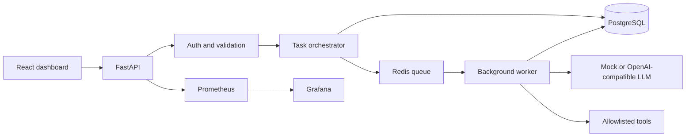

# AgentForge

AgentForge is a small distributed control plane for running tenant-scoped AI agent tasks. A person submits work from a React dashboard. FastAPI authenticates the request, stores the task in PostgreSQL, and places the task id on a Redis queue. A worker claims it, calls either a local mock model or an OpenAI-compatible API, runs an allowlisted tool, and writes the result and step log back to PostgreSQL.

It is a portfolio project for backend, API, and GenAI-platform interviews. It is not a hosted product, and it has no production users.

## What it demonstrates

- Authenticated, tenant-isolated task APIs
- Durable execution state, retries, leases, and dead letters
- A mock model path that runs without a paid API key, plus an optional external LLM provider
- SSRF checks on user-controlled HTTP tool calls
- Prometheus metrics and a provisioned Grafana dashboard

## Features that work

- Register, log in, refresh, log out, update a profile, and change a password
- Create, edit, start, pause, and archive agents
- Queue a task, watch it over Server-Sent Events, cancel it, retry it, and read its steps
- Tools limited to `http_request`, `text_transform`, `branch`, and `store_record`
- Idempotency keys so a repeated create returns the original task
- Exponential backoff, then a dead-letter row when retries are exhausted
- Recovery of tasks whose worker lease expired
- Per-user dashboards, activity, stored records, and unresolved dead letters
- Admin aggregate counts that do not include another tenant's content
- `/health`, `/ready`, and `/metrics`

The mock provider does not call a model vendor. For the seeded Support Triage agent it trims the message, classifies urgency, branches to `priority` or `standard`, and stores a record. Set `LLM_PROVIDER=openai` and `LLM_API_KEY` only when you want the OpenAI-compatible client. That client is covered by a unit test with a fake HTTP transport. This repository's live demo uses the mock.

## Stack

| Piece | Role |
| --- | --- |
| FastAPI | HTTP API, validation, auth, SSE |
| PostgreSQL | Users, agents, tasks, steps, records, dead letters |
| Redis | Queue, delayed retries, rate limits, refresh-token ids, short dashboard cache, live events |
| Worker | Claims tasks, runs the model and tools, writes terminal state |
| React, TypeScript, Vite | Dashboard |
| Prometheus and Grafana | Scrape `/metrics` and show the provisioned dashboard |
| Docker Compose | Runs the services together |

PostgreSQL is the source of truth for completed work. Redis is coordination only.



## Repository structure

```text
backend/          FastAPI app, worker, Alembic migration, Pytest suite
frontend/         React dashboard
monitoring/       Prometheus scrape config and Grafana provisioning
scripts/          verify_http.py for a running API
docker-compose.yml
.env.example
README.md
RUNBOOK.md
PROJECT_STATUS.md
```

## Prerequisites

- Docker with Compose, for the full system
- Python 3.12 or 3.13, for backend tests without Compose
- Node.js 22, for the frontend

## Run with Docker Compose

From the repository root:

```bash
docker compose up --build
```

Compose supplies local defaults, including a development-only JWT secret. Copy `.env.example` to `.env` only when you want to override those defaults. Compose reads `.env` for variable substitution. Do not put a real API key in a file you commit. `.env` is gitignored. `.env.example` contains placeholders and public demo values only.

The API container runs `alembic upgrade head` and, unless `SEED_DEMO=false`, seeds the demo accounts. There is no separate manual migration step for Compose.

| Surface | URL |
| --- | --- |
| Dashboard | http://localhost:8080 |
| API docs | http://localhost:8000/docs |
| Health | http://localhost:8000/health |
| Readiness | http://localhost:8000/ready |
| Prometheus | http://localhost:9090 |
| Grafana | http://localhost:3000 |

Grafana's local login is `admin` / `admin` unless `GRAFANA_ADMIN_PASSWORD` is set. The provisioned dashboard is in the AgentForge folder.

### Demo login

These accounts exist only when `SEED_DEMO=true` and `ENVIRONMENT` is not `production`. Production startup refuses the default demo password. They are public sample credentials, not personal accounts.

| Role | Email | Password |
| --- | --- | --- |
| Operator | `demo@example.com` | `DemoPass123!` |
| Admin | `admin@example.com` | `AdminPass123!` |

Open **Support Triage** and submit:

```text
Urgent: customer cannot log in to the billing portal
```

The seeded operator already has one completed run of that message.

## Run the tests without Docker

Backend tests use SQLite and fakeredis. They do not need Postgres, Redis, or an API key.

```powershell
cd backend
python -m venv .venv
.\.venv\Scripts\python -m pip install -r requirements.txt -r requirements-dev.txt
.\.venv\Scripts\python -m pytest
```

```bash
cd backend
python -m venv .venv
.venv/bin/python -m pip install -r requirements.txt -r requirements-dev.txt
.venv/bin/python -m pytest
```

Frontend, from `frontend/`:

```bash
npm install
npm test
npm run build
npm run dev
```

`npm run dev` serves Vite on port 5173 and proxies `/api`, `/health`, `/ready`, and `/docs` to `http://localhost:8000`. Point `DATABASE_URL` and `REDIS_URL` at reachable services before starting the API outside Compose. The example URL uses the Compose hostname `postgres`, which resolves only on the Compose network.

To exercise a running API:

```bash
python scripts/verify_http.py
```

Set `AGENTFORGE_BASE_URL` if the API is not on `http://localhost:8000`.

## Environment variables

| Variable | Purpose |
| --- | --- |
| `ENVIRONMENT` | `development`, `test`, or `production`. Production rejects a weak `JWT_SECRET` and the default demo password. |
| `LOG_LEVEL` | Python log level. Logs are JSON on stdout. |
| `DATABASE_URL` | SQLAlchemy URL. Compose uses PostgreSQL. |
| `REDIS_URL` | Queue, cache, rate limits, and refresh tokens. |
| `JWT_SECRET` | HMAC secret. Use at least 32 unique characters in production. |
| `JWT_ALGORITHM` | Default `HS256`. |
| `ACCESS_TOKEN_MINUTES` | Access-token lifetime. Default 30. |
| `REFRESH_TOKEN_DAYS` | Refresh-token lifetime. Default 7. |
| `LLM_PROVIDER` | `mock` or `openai`. |
| `LLM_API_KEY` | Required only for `openai`. Leave empty for the mock. |
| `LLM_BASE_URL` | OpenAI-compatible base URL. |
| `LLM_MODEL` | Default model name when an agent does not set one. |
| `LLM_TIMEOUT_SECONDS` | Provider request timeout. |
| `CORS_ORIGINS` | Comma-separated browser origins. |
| `RATE_LIMIT_PER_MINUTE` | Authenticated API limit per user. |
| `TASK_RATE_LIMIT_PER_MINUTE` | Task-create limit per user. |
| `LOGIN_RATE_LIMIT_PER_MINUTE` | Login and registration limit. |
| `RETRY_BASE_SECONDS` | Base delay for exponential backoff. |
| `RETRY_MAX_SECONDS` | Cap for that delay. |
| `SEED_DEMO` | Seed the demo users, agent, and one completed task. |
| `DEMO_USER_EMAIL` / `DEMO_USER_PASSWORD` | Demo operator. |
| `ADMIN_USER_EMAIL` / `ADMIN_USER_PASSWORD` | Demo admin. |
| `TRUST_PROXY` | Trust `X-Forwarded-For`. Compose sets this on the API because nginx is the proxy. |
| `POSTGRES_USER` / `POSTGRES_PASSWORD` / `POSTGRES_DB` | Postgres image settings. |
| `GRAFANA_ADMIN_USER` / `GRAFANA_ADMIN_PASSWORD` | Grafana local admin. |

## API

Interactive schemas are at `/docs`. Send `Authorization: Bearer <access_token>` on the routes below except health, readiness, metrics, register, and login.

| Method | Path | Purpose |
| --- | --- | --- |
| POST | `/api/v1/auth/register` | Create a user and return tokens |
| POST | `/api/v1/auth/login` | Log in |
| POST | `/api/v1/auth/refresh` | Rotate a refresh token |
| POST | `/api/v1/auth/logout` | Revoke a refresh token |
| GET, PATCH | `/api/v1/auth/me` | Read or update the profile |
| POST | `/api/v1/auth/change-password` | Change the password |
| GET, POST | `/api/v1/agents` | List or create agents |
| GET, PATCH, DELETE | `/api/v1/agents/{id}` | Read, update, or archive |
| POST | `/api/v1/agents/{id}/start` | Start a draft or paused agent |
| POST | `/api/v1/agents/{id}/pause` | Pause an active agent |
| POST | `/api/v1/agents/{id}/tasks` | Queue a task. Optional `Idempotency-Key` header |
| GET | `/api/v1/tasks` | List tasks. Filters: `q`, `status`, `agent_id`, `dead_letter` |
| GET | `/api/v1/tasks/{id}` | Task plus steps |
| POST | `/api/v1/tasks/{id}/cancel` | Cancel a non-terminal task |
| POST | `/api/v1/tasks/{id}/retry` | Requeue a failed task |
| GET | `/api/v1/tasks/{id}/events` | Server-Sent Events |
| GET | `/api/v1/dashboard` | Counts, recent work, and dependency checks |
| GET | `/api/v1/activity` | Activity page |
| GET | `/api/v1/records` | Stored tool records |
| GET | `/api/v1/dead-letters` | Unresolved dead letters |
| GET | `/api/v1/admin/overview` | Admin counts only |
| GET | `/health`, `/ready`, `/metrics` | Process, dependencies, Prometheus |

Task statuses are `pending`, `queued`, `running`, `completed`, `failed`, and `cancelled`.

Example, after copying the access token from login:

```bash
curl -s http://localhost:8000/api/v1/auth/login \
  -H "content-type: application/json" \
  -d "{\"email\":\"demo@example.com\",\"password\":\"DemoPass123!\"}"
```

```bash
curl -s http://localhost:8000/api/v1/agents/$AGENT_ID/tasks \
  -H "authorization: Bearer $TOKEN" \
  -H "content-type: application/json" \
  -H "Idempotency-Key: demo-run-001" \
  -d "{\"input\":{\"text\":\"Urgent: customer cannot log in to the billing portal\"}}"
```

Repeating that key returns the same task and sets `Idempotency-Replayed: true`.

## Tests recorded for this tree

Run on 14 October 2026 from the commands above:

- Backend: `.\.venv\Scripts\python -m pytest -q` — 45 passed.
- Frontend: `npm test` — 5 passed. `npm run build` completed `tsc --noEmit` and the Vite production build.
- `docker compose config --quiet` exited 0. `docker compose up -d` started the existing images, and the API readiness check became healthy.
- `python scripts/verify_http.py` exited 0. It registered a user, created and started an agent, completed the urgent billing task through the mock provider, confirmed an idempotent replay and the SSE snapshot, saw a second user get 404, and saw a request to `169.254.169.254` finish failed and dead-lettered. The demo login and dashboard check also passed.

There is no screenshot in the repository. Use the dashboard after Compose is up.

## Security

- Passwords are bcrypt hashes. Access tokens are short-lived HS256 JWTs. Refresh token ids live in Redis and rotate on use.
- The browser stores tokens in `localStorage`, which is exposed to XSS. This is a demo choice, not a production session design.
- Users can access only their own agents, tasks, records, and dead letters. Missing resources return 404.
- The HTTP tool rejects non-HTTP schemes, credentials in URLs, localhost, private, link-local, reserved, multicast, unspecified, and cloud-metadata addresses. DNS answers are checked, and each redirect is checked again. A public hostname still has a small DNS time-of-check/time-of-use window.
- The worker does not run shell commands or generated code. Tool arguments are schema-checked.
- Request bodies are limited to 1 MB. Login, general API use, and task creation are rate limited.
- Compose sets `TRUST_PROXY=true` so nginx can pass the client IP. Do not expose port 8000 to untrusted clients with that flag on, because `X-Forwarded-For` can be spoofed.
- `npm audit --omit=dev` reports two moderate React Router advisories. The suggested fix is a major upgrade to React Router 7, which this app has not adopted. The critical audit findings are in development dependencies, including Vitest. They are not fixed by a lockfile-only patch.
- No license file is included yet. See the note below.

Operational failures are described in [RUNBOOK.md](RUNBOOK.md). [PROJECT_STATUS.md](PROJECT_STATUS.md) records implementation scope and verification notes.

## Known limits

- One worker process type, not Celery and not a multi-region scheduler
- Mock decisions are deterministic rules, not a general model
- SSE closes after a terminal status or about 120 seconds
- Frontend automated tests cover formatting and the status badge, not full browser flows
- Local Postgres and Redis ports are published by Compose for debugging

## License and contributions

This repository does not currently include a license. Until one is added, do not assume you may reuse the code. Issues and small pull requests are welcome once the repository is public. Please do not file secrets, production data, or vulnerability exploits as public issues.
